<p align="center">
  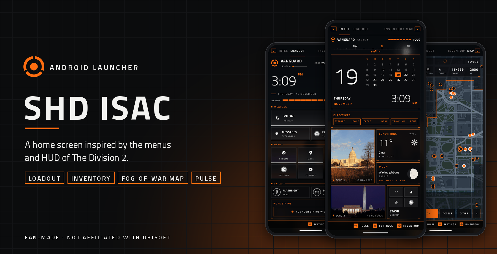
</p>

<h3 align="center">Turn your phone into an agent's ISAC.</h3>

<p align="center">
  Your apps become loot. Your favourites become a loadout. The streets you travel clear the fog on a living map.
</p>

<p align="center">
  <a href="https://github.com/Technically-Possible/isac-launcher/releases/latest"></a>
  
  
  
  <a href="LICENSE"></a>
</p>

<p align="center">
  <a href="https://github.com/Technically-Possible/isac-launcher/releases/latest"><b>Download the APK</b></a> ·
  <a href="#features">Features</a> ·
  <a href="#install">Install</a> ·
  <a href="#guides">Guides</a> ·
  <a href="#privacy">Privacy</a> ·
  <a href="#build-it-yourself">Build</a> ·
  <a href="#credits">Credits</a>
</p>

---

<table>
<tr>
<td width="42%" align="center">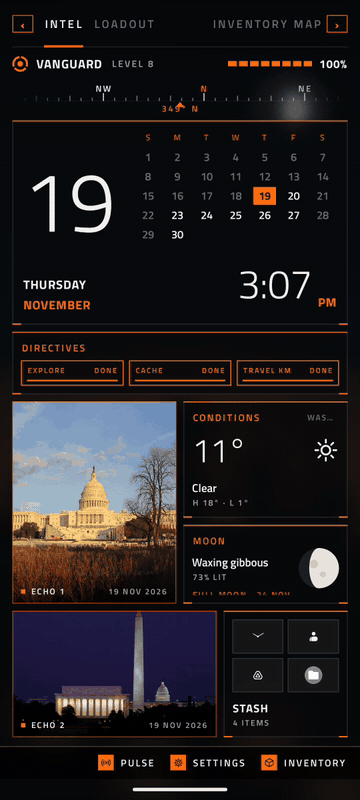</td>
<td>

### A home screen that plays like a game menu

SHD ISAC is a full Android home screen, styled after the menus and HUD of Tom Clancy's The Division 2. It isn't a skin over another launcher. Everything is built for it: the tabs, panels, rarity colours, the loading screen and the map.

- **Intel:** a dashboard with your calendar, weather, moon phase and photos.
- **Loadout:** your go-to apps, equipped as weapons, gear and skills.
- **Inventory:** every app is loot, with a rarity that comes from how much you use it.
- **Map:** a fog-of-war map that clears as you explore, with levels, cities and landmark caches.
- **Pulse:** a radar scan of nearby devices, with ISAC reading your status aloud.

Your level comes only from exploring, never from step counts. It works however you get around: on foot, by wheelchair, by bike, by bus or by car.

</td>
</tr>
</table>

## Features

### Intel: your dashboard

<table>
<tr>
<td width="34%">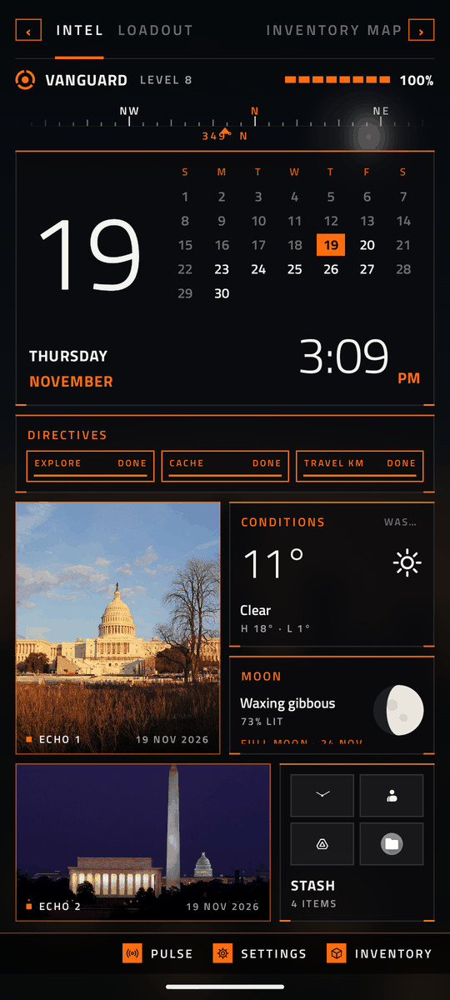</td>
<td>

Everything you glance at, on one page that never needs scrolling.

- **Calendar:** a big date beside the whole month, with dots on days that have events.
- **Clock:** 12- or 24-hour.
- **Compass:** a live heading, with a waypoint to your Base of Operations (home) and the distance to it.
- **Directives:** small daily goals, such as uncovering new streets or recovering a cache. Each one pays XP.
- **Conditions:** the current weather in °C, with today's high and low.
- **Moon:** the moon's phase, how much of it is lit, and the date of the next full moon.
- **Two photo frames, Echo 1 and Echo 2:** each one holds any photo widget, or cycles through a folder you choose.
- **Stash:** a folder for the apps you want close but not in your loadout.

</td>
</tr>
</table>

### Loadout: your go-to apps

<table>
<tr>
<td>

Equip your most important apps the way an agent equips a build.

- **Weapons:** Primary, Secondary and Sidearm hold the three apps you reach for most.
- **Gear:** six more slots.
- **Skills:** the torch, and Pulse. Hold Pulse to give a voice command.
- **Armor:** your battery. It pulses while charging and turns red when it's critical.
- **Core:** the phone's temperature.
- **Work status:** a slot for any widget, such as Slack's custom status widget.

</td>
<td width="34%">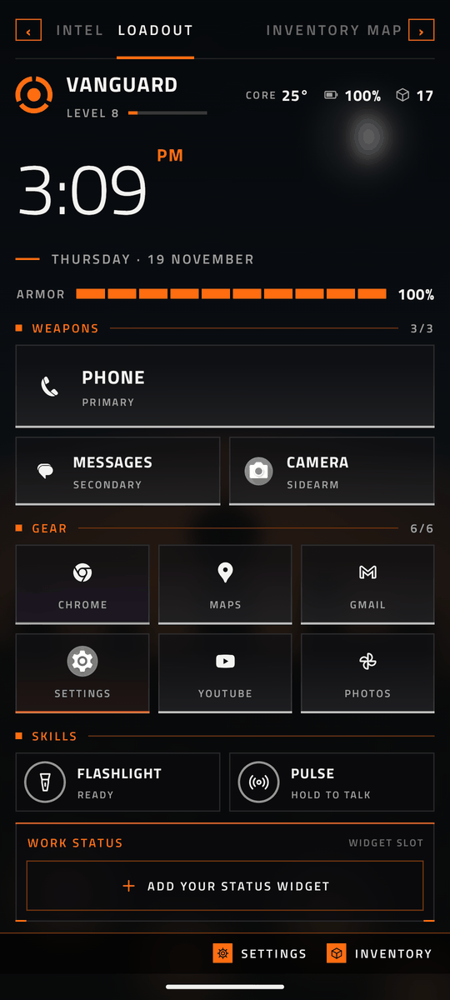</td>
</tr>
</table>

### Inventory: every app is loot

<table>
<tr>
<td width="34%">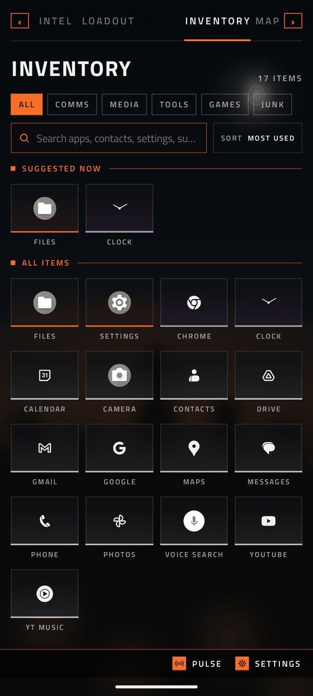</td>
<td width="34%">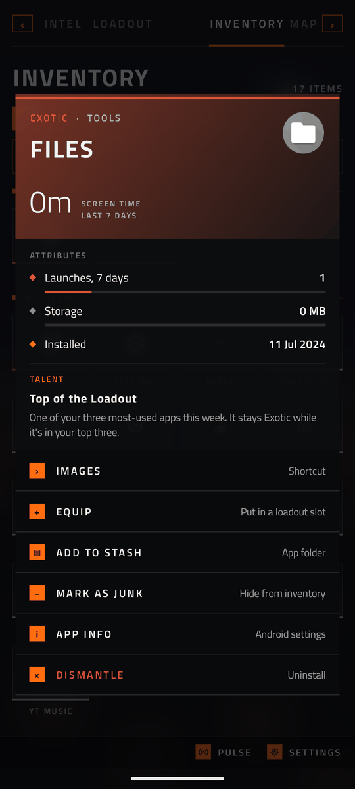</td>
<td>

Each app gets a **rarity** from how you use it. Your top three are **Exotic**. Apps you haven't opened in 90 days turn **Worn**, so you can see what to dismantle.

- **Filters:** Comms, Media, Tools and Games.
- **Sorting:** by most used, or A to Z.
- **Suggested now:** the apps you usually open at this time of day.
- **Notification counters:** an orange count on apps with unread notifications.
- **Item details:** long-press any app to see its screen time, launches, storage, its *talent* and its shortcuts. From there you can Equip it, add it to the Stash, mark it as Junk or Dismantle it (uninstall).

</td>
</tr>
</table>

### Universal search

<table>
<tr>
<td>

One box for everything. Type in the Inventory search, or swipe up on the home page.

- **Apps and contacts.**
- **Android settings:** type "wifi" to jump straight to Wi-Fi.
- **Sums:** `12 x 7 + 3`, `2^10` or `80 * 15%`.
- **Unit conversion:** `5 km in miles`, `180 lb in kg` or `350 f in c`.
- **The web:** a web search, only when you tap it.

</td>
<td width="34%">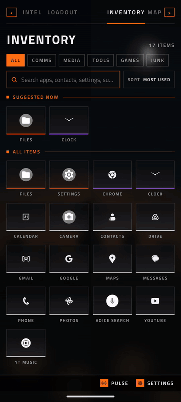</td>
</tr>
</table>

### Map: fog of war

<table>
<tr>
<td width="34%">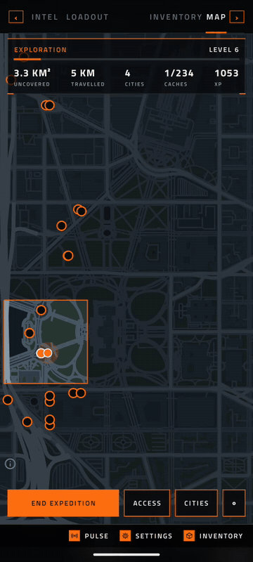</td>
<td width="34%">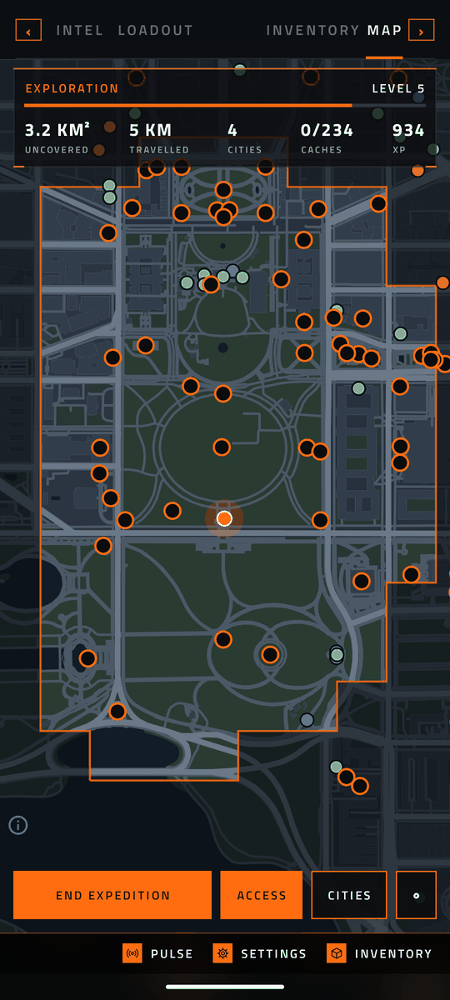</td>
<td>

The world starts dark. Everywhere you go clears the fog, one street-sized cell at a time.

- **Level up:** you earn XP for new cells, distance travelled and new cities.
- **Unlock cities:** each new town or city you visit is added to your record.
- **Landmark caches:** real landmarks nearby, from OpenStreetMap, show as caches. Go near one to recover it for bonus XP.
- **Expeditions:** start one before a trip to draw your whole route.
- **ACCESS:** shows places marked in OpenStreetMap as having full or limited wheelchair access, and accessible toilets.
- **Tracking:** your choice of Always, While open, or Off. Your map never leaves your phone.

</td>
</tr>
</table>

### Level rewards

Levelling up unlocks new **accent colours** for the whole interface (Signal Amber, Tech Cyan, Field Green, Echo Violet and High-End Gold) and new **city skies** (Night Ops, Winter and Dark Zone).

<table>
<tr>
<td align="center" width="33%"><br><sub>SHD ORANGE · LEVEL 1</sub></td>
<td align="center" width="33%">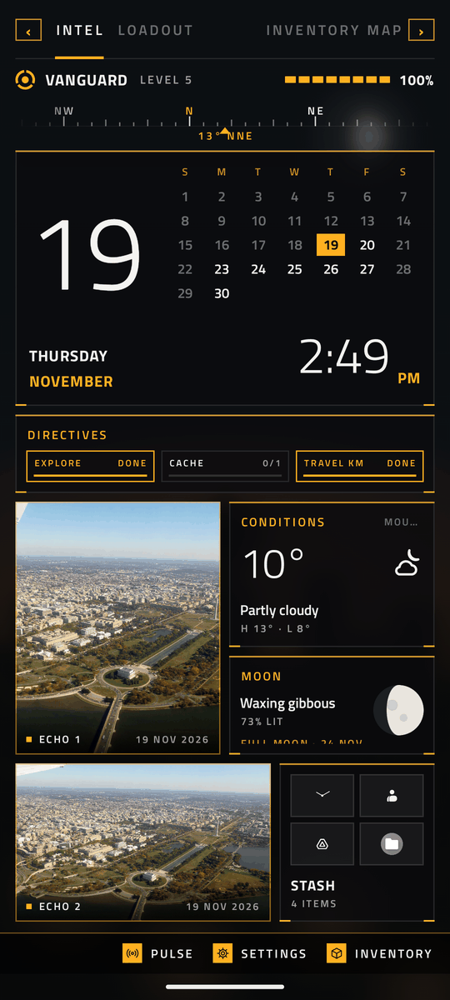<br><sub>SIGNAL AMBER · LEVEL 3</sub></td>
<td align="center" width="33%">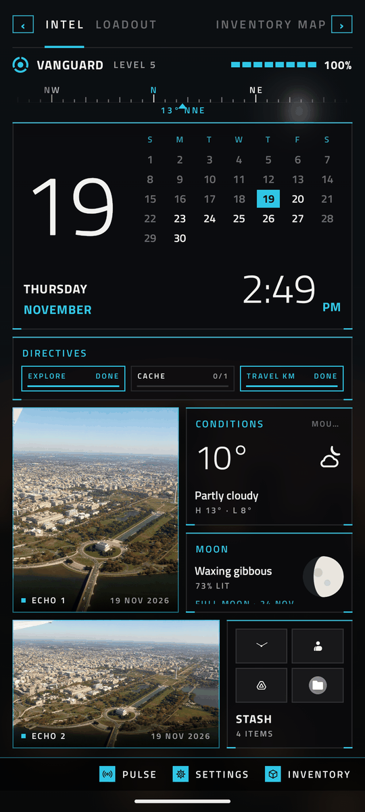<br><sub>TECH CYAN · LEVEL 5</sub></td>
</tr>
</table>

### Field HUD and Pulse

<table>
<tr>
<td width="34%">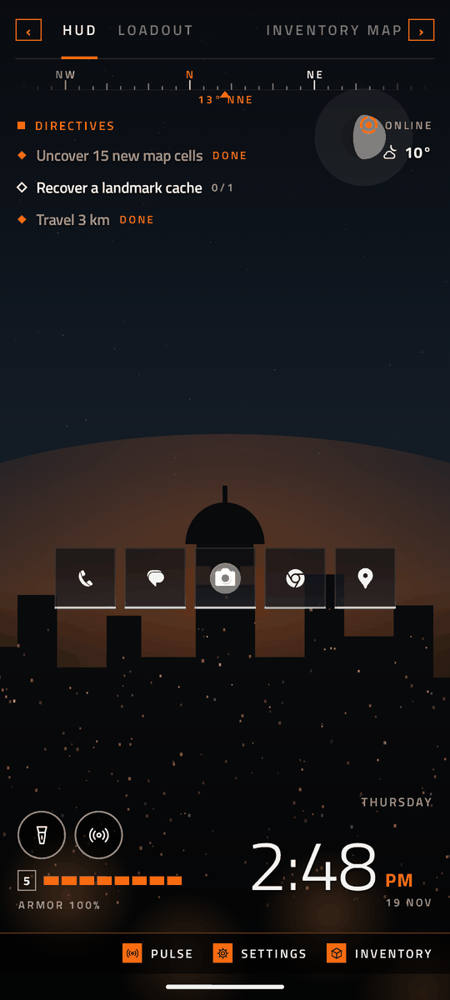</td>
<td width="34%">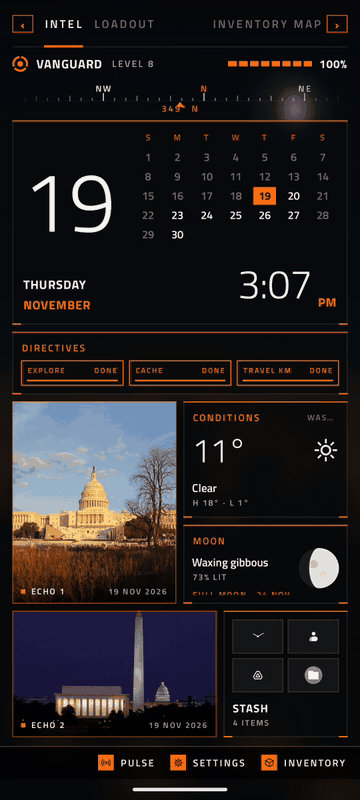</td>
<td>

**Field HUD** is an alternative first page. It shows the city skyline with only the essentials on top, like the in-game HUD: directives, a minimap, your weapons, skills, armor and the time.

**Pulse** scans for nearby Bluetooth devices and Wi-Fi networks and plots them on a radar. You can track one device as you move. Tap Pulse or **shake your phone**, and ISAC reads your status aloud.

**Voice commands** can run fully offline, with a one-off 41 MB voice pack. Hold the Pulse skill and say things like:

- "open Spotify"
- "timer 5 minutes"
- "alarm 7:30"
- "torch on"
- "weather"
- "sitrep"
- "take me home"

</td>
</tr>
</table>

### A living city

<table>
<tr>
<td>

The dusk skyline behind every page is drawn live, and it reacts to the phone's sensors.

- **Sky:** follows the real sun position and your local weather.
- **Parallax:** the skyline shifts as you tilt the phone.
- **Sensors:** a barometer altitude reading, and core temperature from the battery.
- **Stealth:** turn on Do Not Disturb and ISAC goes dark, with a STEALTH tag on the dashboard.
- **Haptics:** ticks and confirmations, which you can turn off.
- **Loading screen:** a Base of Operations screen with a tip, after a restart.

</td>
<td width="34%"></td>
</tr>
</table>

### And the launcher essentials

- **Icon packs:** most icon packs made for other launchers work. You can also choose white or orange line icons, or the original icons.
- **App shortcuts:** long-press for an app's shortcuts. Shortcuts that apps pin to the home screen also work.
- **Android 15 private space:** supported, including locking it.
- **Now playing:** shows what's playing in your music app, with controls.
- **Gestures:**
  - Swipe down on the tabs for notifications.
  - Swipe up to search.
  - Double-tap an empty spot to lock the phone.
- **Morning briefing:** the first time you open ISAC each morning, it reads out the weather, your first event and your battery.
- **Backup and restore:** your settings, loadout, stash and exploration map in one file.

<table>
<tr>
<td align="center" width="25%">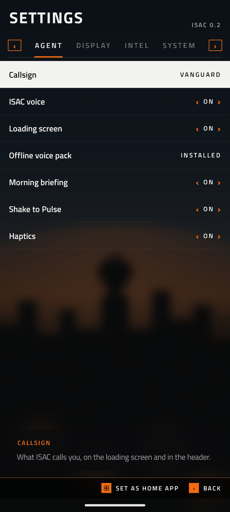<br><sub>SETTINGS</sub></td>
<td align="center" width="25%">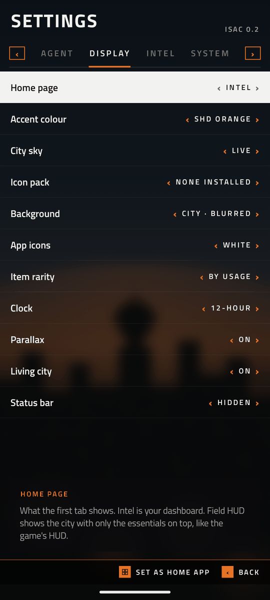<br><sub>DISPLAY</sub></td>
<td align="center" width="25%">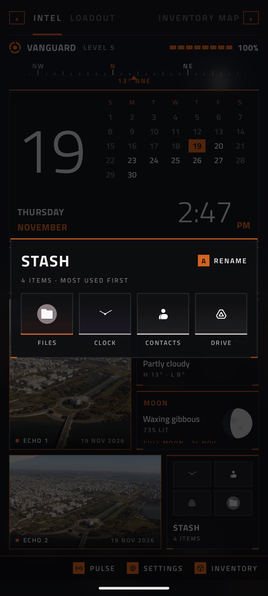<br><sub>STASH</sub></td>
<td align="center" width="25%">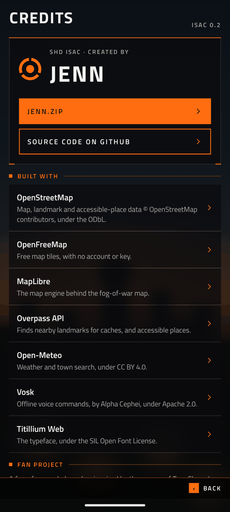<br><sub>CREDITS</sub></td>
</tr>
</table>

## Install

1. On your phone, open the [latest release](https://github.com/Technically-Possible/isac-launcher/releases/latest) and download the `.apk` file.
2. Open the file. If Android asks, allow your browser or Files app to install apps.
   - SHD ISAC isn't on the Play Store, so Play Protect may ask you to confirm.
3. Open **SHD ISAC**, tap **Settings** at the bottom, and choose **Set as home app**. Pick SHD ISAC.

Your old launcher stays installed. You can switch back any time (see [the guide](#go-back-to-your-old-launcher)).

**Requirements:**
- Android 8.0 or later.
- An ARM64 phone. Almost every phone from the last several years is one.

### Permissions

Every permission is optional. The launcher works without them, and each feature asks only when you first use it.

| Permission | What it's for |
| --- | --- |
| Location | Weather, the compass waypoint, and the exploration map |
| Location all the time | Only if you set exploration tracking to *Always* |
| Calendar | Event dots on the calendar, and your next event |
| Usage access | Rarity, sorting and suggestions |
| Notification access | Notification counters and now playing. It counts notifications; it never reads or stores them |
| Nearby devices | Pulse's Bluetooth and Wi-Fi scan |
| Microphone | Voice commands, which are processed on the phone |
| Contacts | Contacts in search results |
| Accessibility service | Only for double-tap to lock and the notifications gesture. It doesn't read the screen |

## Guides

<details>
<summary><b>Set up your photo frames</b></summary>

Each frame on the Intel page can hold either a photo widget or a folder of photos.

- **Widget:** tap **+ PHOTO WIDGET** on a frame and choose any photo widget you already use. Some photo widget apps can import the photos from a widget you already have.
- **Folder:** tap **OR CHOOSE A FOLDER** and pick a folder. Only that folder is shared with the launcher.
  - Tap a frame to skip to the next photo.
  - To change how often photos change by themselves, go to **Settings → Intel → New photo every**.

You can long-press a frame at any time to change what's in it.
</details>

<details>
<summary><b>Add your work-status widget</b></summary>

At the bottom of the Loadout page, tap **+ ADD YOUR STATUS WIDGET** and choose a widget. Slack's custom status widget lets you set your status without opening Slack, but any widget works. To change it later, go to **Settings → Intel → Work status**.
</details>

<details>
<summary><b>Build your loadout</b></summary>

1. In the Inventory, long-press any app and choose **EQUIP**.
2. Pick a slot: Primary, Secondary, Sidearm, or one of the six gear slots. Whatever was in that slot goes back to your inventory.

You can also tap an empty slot on the Loadout page to choose what goes in it.
</details>

<details>
<summary><b>Use the Stash</b></summary>

Long-press an app and choose **ADD TO STASH**. Tap the Stash on the Intel page to open it. Inside the Stash, tap **RENAME** to name it whatever you like.
</details>

<details>
<summary><b>Junk and dismantle</b></summary>

- **Mark as junk** hides an app from your inventory without uninstalling it. Junk apps are listed under the **JUNK** filter.
  - To put every junk app back, go to **Settings → System → Junk items**.
- **Dismantle** uninstalls the app. Android asks you to confirm first.
</details>

<details>
<summary><b>Set your Base of Operations</b></summary>

When you're at home, go to **Settings → Intel → Base of Operations** and tap **SET HERE**. The compass then shows a waypoint to home with the distance to it. When you arrive home, you get the Base of Operations screen.
</details>

<details>
<summary><b>Exploration tracking and Expeditions</b></summary>

Go to **Settings → Intel → Exploration tracking** and choose a mode:

- **While open:** maps only when SHD ISAC is on screen.
- **Always:** keeps mapping in the background. Android asks you to allow location all the time.
- **Off:** no mapping.

Before a journey, open the Map and tap **START EXPEDITION**. ISAC then uses precise location for the whole trip, so your full route is drawn, and shows a notification while the expedition runs. Tap **END EXPEDITION** when you arrive.

If the map doesn't clear, check that the app is allowed to use your precise location. Approximate location is too rough to clear streets.
</details>

<details>
<summary><b>Offline voice commands</b></summary>

1. Go to **Settings → Agent → Offline voice pack** and download it, once (41 MB). Voice commands then work with no internet connection, even on phones without Google's speech services.
2. Hold the **Pulse** skill on the Loadout page and speak.

Commands include:
- "open *app*"
- "timer 10 minutes"
- "alarm 6:45 am"
- "torch on" or "torch off"
- "weather"
- "status" or "sitrep"
- "pulse"
- "take me home"
- a page's name, such as "map"
</details>

<details>
<summary><b>Gestures and double-tap to lock</b></summary>

Swiping down for notifications and up for search work straight away. Double-tap to lock needs SHD ISAC's accessibility service, which is the way other launchers do it too.

1. Go to **Settings → System → Lock and notification gestures** and turn on **SHD ISAC gestures**.
2. If Android says the setting is restricted, open App info for SHD ISAC, tap ⋮, choose **Allow restricted settings**, and try again.
</details>

<details>
<summary><b>Notification counters</b></summary>

Go to **Settings → System → Notification counters** and allow notification access. Apps with unread notifications get an orange count. Now playing uses the same access.
</details>

<details>
<summary><b>Icon packs</b></summary>

Install an icon pack, then go to **Settings → Display → Icon pack** and choose it. Apps the pack doesn't cover use your chosen style instead. You can pick that style under **App icons**.
</details>

<details>
<summary><b>Back up and restore</b></summary>

**Settings → System → Save backup** writes these to a file you choose:
- your settings
- your loadout
- your Stash
- your exploration map

**Restore backup** loads that file on a new phone. Widgets and photo folders aren't included, because they belong to the phone they were set up on.
</details>

<details>
<summary><b>Go back to your old launcher</b></summary>

Go to **Settings → System → Set as home app** (or Android's **Settings → Apps → Default apps → Home app**) and choose your old launcher. SHD ISAC keeps your setup in case you come back.
</details>

## Privacy

There are no accounts, ads, analytics or trackers. Your exploration map, usage stats, loadout and settings are stored only on your phone.

The launcher connects to these free services, and only for what's listed:

| Service | When | What's sent |
| --- | --- | --- |
| [OpenFreeMap](https://openfreemap.org) | When you open the map | Requests for the map tiles on screen |
| [Overpass API](https://overpass-api.de) | When you're in, or scroll the map to, an area it hasn't checked yet (at most once a minute) | That area's boundaries, to find landmarks and accessible places |
| [Open-Meteo](https://open-meteo.com) | Every so often, for the weather | Your location rounded to about 1 km, or the town you typed |
| [Alpha Cephei](https://alphacephei.com/vosk) | Once, if you download the voice pack | A download request only |
| [DuckDuckGo](https://duckduckgo.com) | Only when you tap a web search result | Your search |

The name of the city you're in comes from Android's own geocoder. Which service that uses depends on your phone.

## Build it yourself

You need JDK 17 and the Android SDK with platform 35.

```bash
git clone https://github.com/Technically-Possible/isac-launcher.git
cd isac-launcher
./gradlew assembleRelease     # app/build/outputs/apk/release/app-release.apk
```

- **Signing:** the release build is minified and signed with your local debug key, so it installs over a debug build and keeps its data. A Play Store release would need its own key.
- **Toolchain:** Kotlin 2.2, AGP 8.13, Jetpack Compose (BOM 2025.06), MapLibre 12 and Vosk 0.3.70 (built for 16 KB pages).
- **ABIs:** native code is built for `arm64-v8a` (phones) and `x86_64` (emulators).
- **Design rounds:** the design mock-ups the launcher was built from are in [`design/`](design/).

## Credits

<table>
<tr>
<td width="34%"></td>
<td>

**Created by Jenn.** Find more at **[jenn.zip](https://jenn.zip)**.

The launcher has its own Credits page, under **Settings → System → Credits**.

Built with:
- [MapLibre Native](https://maplibre.org): the map engine.
- [OpenFreeMap](https://openfreemap.org): map tiles.
- [OpenStreetMap](https://www.openstreetmap.org/copyright): map, landmark and accessibility data © OpenStreetMap contributors, under the ODbL.
- [Overpass API](https://overpass-api.de): landmark and accessibility queries.
- [Open-Meteo](https://open-meteo.com): weather and town search, under CC BY 4.0.
- [Vosk](https://alphacephei.com/vosk) by Alpha Cephei: offline speech recognition, under Apache 2.0.
- [Titillium Web](https://fonts.google.com/specimen/Titillium+Web): the typeface, under the SIL Open Font License.

The photos in the screenshots are public-domain images from Wikimedia Commons:
- [Dusk view of the Lincoln Memorial, Washington Monument and U.S. Capitol](https://commons.wikimedia.org/wiki/File:Dusk_view_of_the_Lincoln_Memorial,_Washington_Monument_and_U.S._Capitol,_Washington,_D.C_LCCN2011631138.tif)
- [Golden November Sunset on the Capitol](https://commons.wikimedia.org/wiki/File:Golden_November_Sunset_on_the_Capitol_(10731986515).jpg)
- [Aerial view of National Mall](https://commons.wikimedia.org/wiki/File:Aerial_view_of_National_Mall.jpg)
- [West Front of Capitol Sunset](https://commons.wikimedia.org/wiki/File:West_Front_of_Capitol_Sunset_(8365553030).jpg)

The demo runs in Washington, D.C., with the White House as Base of Operations, because where else would it be.

</td>
</tr>
</table>

## Fan project

SHD ISAC is a free, fan-made launcher inspired by the menus of *Tom Clancy's The Division 2*. All its artwork and icons are original, and the city backdrop is drawn in code.

It isn't affiliated with or endorsed by Ubisoft or Massive Entertainment. *Tom Clancy's The Division*, SHD and ISAC are trademarks of Ubisoft.

The code is under the [MIT licence](LICENSE).
